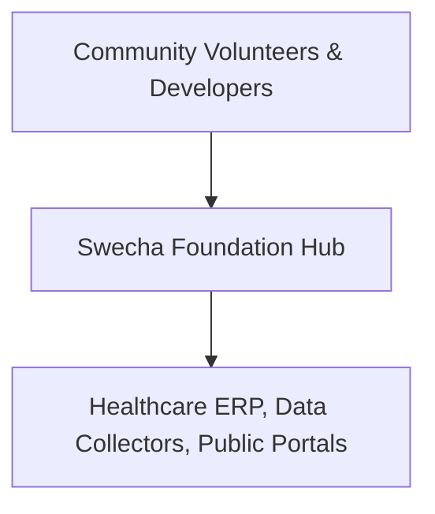
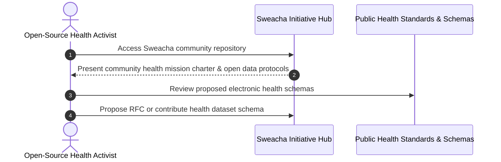

# Swecha — Public Health & Community Open-Data Initiative
[]()
[]()
[]()
[]()

## Overview
A foundational organizational repository for the **Swecha** public health, free software, and open-data community initiative. Designed to host shared community documentation, open-source healthcare specifications, and dataset schemas for grassroots public healthcare and pharmacy access.

- **Problem Solved:** Open collaboration, shared protocols, and public data transparency for community healthcare.
- **Target Users:** Open-source contributors, public health activists, and civic volunteers.
- **Current Status:** Initiative Foundation & Open-Data Repository.

## Features
- **Open Standards & Specifications:** Documentation for community health record schemas.
- **Foundation Scaffold:** Clean baseline for open-source healthcare tools and public data initiatives.

## Architecture


## User Flow


## Technology Stack
| Layer | Technology | Purpose |
|---|---|---|
| Platform | Git & Markdown | Open collaboration and documentation |

## Infrastructure
*Open-source GitHub community repository.*

## Project Structure
```text
sweacha/
├── .gitignore           # Git ignore definitions
└── README.md            # Technical documentation & mission charter
```

## Prerequisites
*Git version control.*

## Environment Variables
*Not required.*

## Local Development Setup
```bash
git clone https://github.com/Bhanutejanallamothu/sweacha.git
cd sweacha
```

## Docker Setup
*Not applicable.*

## Database Setup
*Not applicable.*

## API Documentation
*Not applicable.*

## Deployment
Public open-source repository documentation.

## Security
- Respects community privacy standards; no confidential patient records permitted in public stores.

## Testing
*Not applicable.*

## Troubleshooting
*None.*

## Future Improvements
- Community RFC (Request for Comments) protocol for open healthcare software.

## License
Open-source community project.
